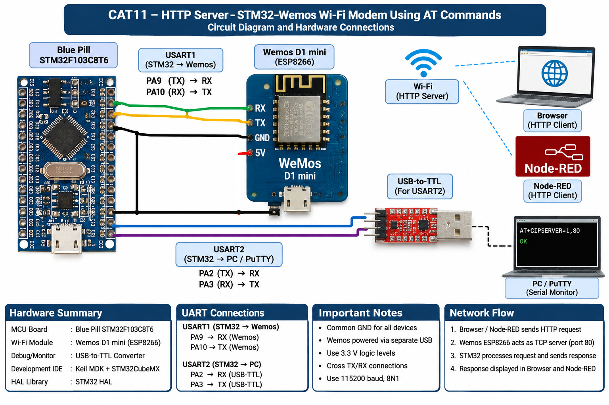

# CAT11 – HTTP Server: STM32–Wemos Wi-Fi Modem Using AT Commands

## Overview
This CAT11 practical is organized into three tasks. The uploaded CAT11 task mapping supplied by the user is followed:
- Original sheet Task 10C → repository TASK11A
- Original sheet Task 10D → repository TASK11B
- Original sheet Task 10E → repository TASK11C

The filename and original CAT10 headings are not used for repository numbering.

## Required Documentation

| Task | Experiment / deliverable | Documentation |
|---|---|---|
| TASK11A | Configure ESP8266 as a TCP server | [TASK11A README](TASK11A/README.md) |
| TASK11B | Observe HTTP request and send static HTTP response | [TASK11B README](TASK11B/README.md) |
| TASK11C | Node-RED as a second HTTP client | [TASK11C README](TASK11C/README.md) |

## Hardware Setup / Platform
- Blue Pill STM32F103C8T6
- Wemos D1 mini (ESP8266)
- USB-to-TTL adapter for USART2 serial monitoring
- Keil MDK / µVision and STM32CubeMX project files
- PuTTY or another serial terminal

### UART Connections

| STM32 signal | Connect to | Purpose |
|---|---|---|
| PA9 / USART1 TX | Wemos RX | STM32 → ESP8266 AT commands |
| PA10 / USART1 RX | Wemos TX | ESP8266 → STM32 responses |
| PA2 / USART2 TX | USB-to-TTL RX | STM32 debug output to PC |
| PA3 / USART2 RX | USB-to-TTL TX | PC serial input to STM32 |
| GND | Common GND | Shared signal reference |

UART settings: 115200 baud, 8-N-1, no flow control. The Wemos D1 mini is powered separately through its USB connector. Keep a common ground between the boards and USB-to-TTL adapter. Use 3.3 V UART logic.

## Circuit Diagram

The diagram shows the overall hardware and network arrangement. Browser and Node-RED are HTTP clients over Wi-Fi; they are not wired directly to the STM32. The Wemos is the Wi-Fi/TCP endpoint, while the STM32 communicates with it over USART1. USART2 connects to the USB-to-TTL serial monitor.

## Experiment Tasks
- **TASK11A:** ESP8266 station-mode setup, Wi-Fi join, multiple-connection mode, and TCP server startup on port 80.
- **TASK11B:** Receive `+IPD` HTTP data, identify the connection, observe the request, and return a static HTML HTTP response.
- **TASK11C:** Import and run the Node-RED Inject → HTTP Request → Debug flow as a second HTTP client.

## Development Environment
- MCU: STM32F103C8T6
- Firmware framework: STM32 HAL
- Configuration/project: STM32CubeMX `.ioc` and Keil MDK/µVision project under each task's `STM32_Project/`
- Serial interface: USART1 for ESP8266; USART2 for USB-to-TTL debugging
- Network: ESP8266 TCP server on port 80; HTTP clients are browser and Node-RED

## Inference
The CAT11 project demonstrates an STM32 communicating with a Wemos D1 mini using ESP8266 AT commands, exposing a TCP/HTTP server, and serving a static HTTP page to browser and Node-RED clients. The firmware response is static HTML, not sensor telemetry.

## Repository Safety Note
Wi-Fi credentials are represented by placeholders in the packaged CAT11 firmware. Before running, configure `WIFI_SSID` and `WIFI_PASSWORD` locally in `Core/Src/main.c`. Do not commit real network credentials to a public repository.
