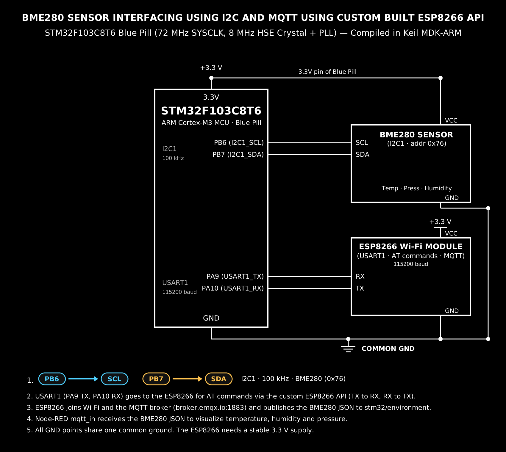

EXPERIMENT DETAILS

EXP: CONTINUOUS ASSESSMENT 14
DATE: 27/10/2026
NAME OF EXP: BME280 Sensor Interfacing Using I²C and MQTT using Custom Built ESP8266 API
HARDWARE SETUP / PLATFORM: STM32 Development Board (Nucleo) + BME280 Sensor + Wemos ESP8266 + STM32CubeMX + Keil MDK (HAL Libraries) + MQTT Broker (broker.emqx.io) + Node-RED

TASK 14: BME280 Sensor Interfacing Using I²C and MQTT using Custom Built ESP8266 API

1. Circuit Diagram
[!CIRCUIT DIAGRAM][./FINAL_CAT14.png]
The experiment establishes a dual-protocol sensing node where the STM32 microcontroller reads compensated temperature, pressure and humidity from a BME280 sensor over the I²C bus, and transmits the readings to an MQTT broker over Wi-Fi using a Wemos ESP8266 driven by the supplied custom AT-command library. The ESP8266 is interfaced on USART2 at 115200 baud, while the MQTT payloads are consumed by Node-RED for analytics.

Development Board: STM32 Development Board (Nucleo, STM32F446RE / F103RB class)
Microcontroller: STM32 (ARM Cortex-M, 3.3 V logic)
Sensor: Bosch BME280 (temperature, pressure, humidity), I²C address 0x76
Wi-Fi Module: Wemos D1 Mini (ESP8266), AT firmware
I²C Peripheral:
  - I2C1 (Standard mode, 100 kHz): BME280 SCL -> I2C1_SCL, BME280 SDA -> I2C1_SDA (pins as assigned in CAT14.ioc)
  - BME280 CSB -> 3.3 V (selects I²C mode), SDO -> GND (sets address 0x76)
UART Peripheral:
  - USART2 (Baud: 115200, 8N1): Connected to ESP8266 (PA2 TX -> ESP RX, PA3 RX <- ESP TX), interrupt enabled for HAL_UART_Receive_IT()
Power Supply: STM32 powered via USB/ST-Link; ESP8266 powered from a dedicated external 3.3 V supply (500 mA or more) — the board's 3.3 V pin is not used for the module.
Ground: Common ground (GND) shared between STM32, BME280, ESP8266 and the supply.
Network: ESP8266 in Station mode, associated with the local access point; MQTT broker broker.emqx.io on port 1883 (unencrypted).

Circuit Diagram

FINAL_CAT14.png is a reference schematic showing the STM32 development board interfaced with the BME280 sensor over I²C and the Wemos ESP8266 over USART2, publishing to an MQTT broker for Node-RED analytics.

2. Core Logic / Pseudocode / Code Base

Working Principle:
The firmware initializes the STM32 HAL library, system clocks, GPIOs, I2C1 and USART2. The BME280 is brought up over I²C, its calibration coefficients are read once at start-up, and every subsequent sample is compensated using the Bosch reference formulas before being converted to engineering units. The supplied custom ESP8266 library (ESPLib.c / ESPLib.h) is then used as a modem driver: the module is initialized in Station mode, joined to the local Wi-Fi network, and connected to the MQTT broker over a TCP socket. The MQTT client parameters (keep-alive, clean session, client ID) are set before the broker connection is opened, after which the firmware publishes the sensor payload to the topic stm32/test/data once per second. A SysTick hook (MQTTTimer()) keeps the library's internal timing alive so keep-alive and retransmission work without blocking the main loop.

Pseudocode:
Initialize the STM32 HAL library and system clock.
Configure GPIO pins and initialize I2C1 (100 kHz) for the BME280.
Initialize USART2 (115200 baud, 8N1) for the ESP8266, with receive interrupt enabled.
Read BME280 calibration coefficients and verify the chip ID.
Enter the main execution block:
  - Initialize the ESP8266 in Station mode: ESP8266_Init(StationMode, huart2).
  - Join the Wi-Fi network: ESP8266_wifiConnect("SSID", "PASSWORD").
  - Open a TCP socket to the broker: ESP8266_portConnect("TCP", "broker.emqx.io", "1883").
  - Configure the MQTT client (keepAlive = 500, connectFlag = CleanSession, clientID = "MqttID").
  - Connect to the broker: MQTT_connectBroker(&mqttSetting).
  - Repeat:
      - Read raw temperature, pressure and humidity registers over I²C.
      - Apply the compensation formulas to obtain compensated values.
      - Format the readings as a JSON payload.
      - Publish to the topic "stm32/test/data" with QoS 0.
      - Wait 1000 ms using a non-blocking tick comparison.

Code Base:
The program is written in Embedded C utilizing STM32CubeMX for hardware configuration and Keil MDK for compilation. The custom ESP8266/MQTT API is supplied as two files, ESPLib.c (Core/Src) and ESPLib.h (Core/Inc), added to the Application/User/Core group in Keil with ..\Core\Inc present in the include paths.
MX_I2C1_Init() and MX_USART2_UART_Init() configure the sensor bus and the modem link.
ESP8266_Init(), ESP8266_wifiConnect(), ESP8266_portConnect(), MQTT_connectBroker(), MQTT_publishTopic() and MQTT_subscribeTopic() form the modem and broker interface.
HAL_I2C_Master_Transmit() and HAL_I2C_Master_Receive() handle the BME280 register access.
MQTTTimer() is called from SysTick_Handler() to drive the library time base.

```c
/* USER CODE BEGIN 2 */
  // 1. Initialize the Wi-Fi module on USART2
  ESP8266_Init(StationMode, &huart2);

  // 2. Connect to the local Wi-Fi network (replace with your router SSID and password)
  ESP8266_wifiConnect("*********", "********");

  // 3. Connect to the MQTT broker — 1883 is the standard unencrypted MQTT port
  ESP8266_portConnect("TCP", "broker.emqx.io", "1883");

  // 4. Configure the MQTT client connection parameters
  MQTT_InitTypeDef_t mqttSetting;
  mqttSetting.keepAlive   = 500;
  mqttSetting.connectFlag = CleanSession;
  mqttSetting.clientID    = "MqttID";
  MQTT_connectBroker(&mqttSetting);
/* USER CODE END 2 */

  while (1)
  {
    BME280_ReadCompensated(&temp, &press, &hum);   // I2C1 read + Bosch compensation
    snprintf(payload, sizeof(payload),
             "{\"node\":\"stm32-cat14\",\"temp_c\":%.1f,\"press_hpa\":%.1f,\"hum_pct\":%.1f}",
             temp, press, hum);

    MQTT_publishTopic("stm32/test/data", payload, QoS0);

    HAL_Delay(1000);
  }

void SysTick_Handler(void)
{
  /* USER CODE BEGIN SysTick_IRQn 0 */
  MQTTTimer();
  /* USER CODE END SysTick_IRQn 0 */
  HAL_IncTick();
  /* USER CODE BEGIN SysTick_IRQn 1 */
  /* USER CODE END SysTick_IRQn 1 */
}
```

3. Inference
The STM32 microcontroller successfully read compensated temperature, pressure and humidity values from the BME280 over the I²C bus and transmitted them to the MQTT broker through the Wemos ESP8266 using the custom AT-command library. The module correctly entered Station mode, associated with the wireless access point, opened a TCP socket to broker.emqx.io on port 1883, and published each sample to the topic stm32/test/data, from where Node-RED received and displayed the readings as analytics. Proper I²C pull-ups and a dedicated, stable 3.3 V supply for the ESP8266 were essential for reliable sensor reads and uninterrupted publishing, and routing the library timer through SysTick_Handler() kept the MQTT keep-alive running without blocking the main loop.